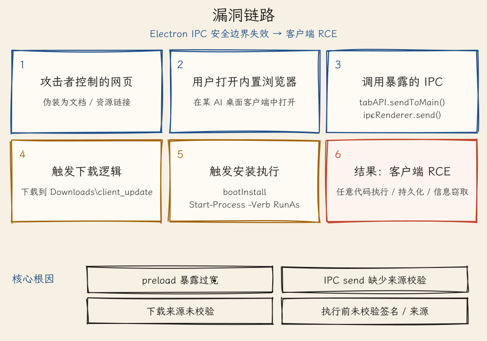
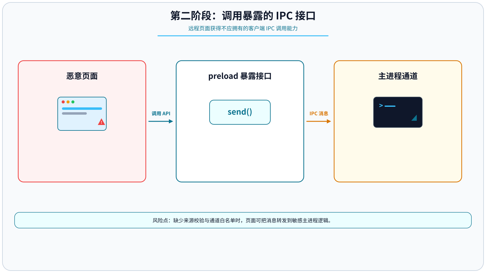
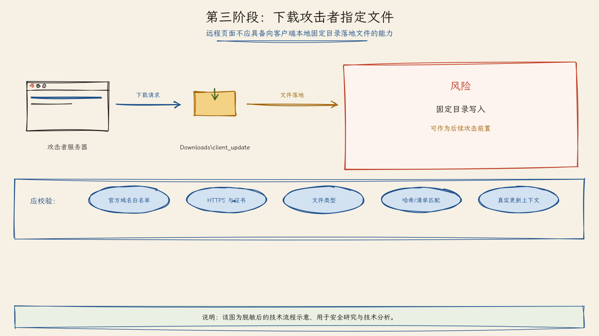

> 本文首发于公众号「0xSY」：[从 Electron IPC 安全边界失效到客户端 RCE](https://mp.weixin.qq.com/s/tBqzGDgYvoLbv9bcJBPu3w)。

## 0x01 前言

随着 AI 桌面客户端逐渐成为用户日常使用大模型能力的重要入口，客户端本身承载的权限也越来越高。与普通网页不同，桌面客户端通常可以访问本地文件、调用系统接口、管理更新流程，甚至与原生进程进行通信。

这类能力一旦没有被正确隔离，就可能导致一个严重问题：**远程网页内容突破浏览器沙箱限制，直接调用客户端本地高权限能力**。

本文分析的是某 AI 桌面客户端中的一个客户端远程代码执行问题。该问题的核心在于：客户端内置浏览器向任意网页暴露了未经充分安全检查的 IPC 接口，攻击者可借助这些接口调用主进程中的更新下载与安装逻辑，最终实现从远程网页到本地代码执行的攻击链。

## 0x02 漏洞概述

该漏洞影响某 AI 桌面客户端 Windows 版本。客户端基于 Electron 架构，在内置浏览器场景中通过 preload 脚本向页面暴露了部分 IPC 通信能力。

正常情况下，网页内容应当被浏览器沙箱隔离，不能直接调用本地系统能力，更不能控制主进程执行敏感操作。但在该客户端中，内置浏览器加载的页面可以调用暴露到 `window` 对象上的 IPC 接口，并向主进程发送特定 IPC 消息。

漏洞链路大致如下。该问题不属于传统意义上的服务端 RCE，而是典型的**客户端 RCE**。攻击入口来自远程页面，但代码执行发生在受害者 Windows 客户端本机。

## 0x03 攻击面背景：Electron 客户端中的 IPC 风险

Electron 应用通常由两部分组成：

- **Renderer Process**：负责展示页面内容。
- **Main Process**：负责窗口管理、系统调用、文件操作、更新逻辑等高权限能力。

为了让页面和主进程通信，Electron 提供了 IPC 机制。合理的 IPC 设计应当遵循以下原则：

1. Renderer 不能直接获得任意 IPC 调用能力。
2. preload 暴露接口必须最小化。
3. IPC 通道必须设置白名单。
4. 高危通道必须校验调用来源。
5. 文件下载、安装、执行等能力必须二次校验。

如果客户端把通用 IPC 发送能力直接暴露给网页，并且主进程中的敏感通道缺少来源、签名或参数校验，那么远程网页就可能从「普通页面」变成「本地能力调用器」。

本次漏洞正是这种问题的典型案例。

## 0x04 漏洞根因分析

### 1. IPC send 接口缺少安全检查

客户端 preload 脚本通过 `contextBridge.exposeInMainWorld` 向页面暴露了类似 `tabAPI.sendToMain()` 和 `ipcRenderer.send()` 的接口。

问题在于，这两个接口可以将消息直接转发到主进程，但没有对调用来源、目标 IPC 通道或页面 URL 进行充分校验。

这意味着，只要用户在客户端内置浏览器中打开攻击者控制的页面，攻击者页面就可能调用客户端暴露的本地能力。

这类问题的本质不是简单的 XSS，也不是普通网页漏洞，而是：**远程网页获得了本不应该拥有的 Electron IPC 调用能力。**

### 2. 更新下载逻辑未校验来源

主进程更新处理逻辑中，下载接口会使用传入的 URL 作为下载地址，并将文件保存到固定的下载目录中，但没有严格校验是否来自官方更新域名，也没有限制协议、文件类型或来源合法性。

这会导致攻击者可以通过 IPC 消息指定一个外部 URL，使客户端从攻击者服务器下载文件到本地。

该问题单独来看，也已经具有较高风险，因为它使远程页面具备了向用户本机固定目录写入文件的能力。

### 3. 安装执行逻辑未校验签名与来源

安装接口接收文件路径后，仅检查文件是否存在，随后调用安装逻辑执行该文件。在 Windows 平台上，执行过程涉及 PowerShell `Start-Process`，并使用 `-Verb RunAs` 请求管理员权限。

这里的问题在于：

1. 没有校验文件是否由官方签名。
2. 没有校验文件是否来自官方更新服务器。
3. 没有严格限制可执行文件类型。
4. 没有将下载与安装流程绑定到可信更新上下文。

因此，当下载和安装执行逻辑被任意网页通过 IPC 串联调用时，就形成了完整的客户端 RCE 攻击链。

## 0x05 漏洞利用链路

从攻击者视角看，该漏洞的利用链路可以概括为以下几个阶段。

### 第一阶段：诱导用户在客户端内置浏览器中打开页面

攻击者可以构造一个普通网页链接，并将其伪装为文档、活动页面、资源领取页面或其他正常内容。

一旦用户在某 AI 桌面客户端的内置浏览器中打开该页面，页面便进入了漏洞触发环境。

这里需要强调的是：如果同样的页面在 Chrome、Edge 等普通浏览器中打开，攻击链无法成立。因为普通浏览器不会暴露客户端主进程 IPC 能力，也不能直接调用本地更新安装逻辑。

### 第二阶段：调用暴露的 IPC 接口

恶意页面加载后，可以调用客户端暴露的 IPC 接口，向主进程发送特定消息。

由于 send 类接口缺少来源和通道限制，攻击者页面能够访问本不应暴露给外部页面的主进程能力。

### 第三阶段：下载攻击者指定文件

随后，攻击者通过更新下载相关 IPC 通道传入外部文件地址。客户端主进程接收后，按照更新流程将文件下载到用户本地目录。

这一步的风险在于：远程页面不应具备向客户端本地固定目录落地文件的能力。

### 第四阶段：触发本地执行

当文件下载完成后，攻击者继续调用安装相关 IPC 通道，传入本地文件路径，使客户端执行该文件。

在验证过程中，可以通过执行无害程序或弹出计算器等方式证明代码执行能力。

至此，攻击链完成。

## 0x06 为什么这是客户端 RCE？

很多人看到「需要用户打开链接」或者「发生在桌面客户端内置浏览器」时，可能会误以为这只是普通网页风险。

但从漏洞定性上看，它应当被归类为**客户端远程代码执行**。

原因有三点。

第一，攻击入口来自远程内容。攻击者只需要控制一个网页，并诱导用户在客户端内置浏览器中访问，即可触发漏洞链路。

第二，代码执行发生在受害者本机。最终被执行的是下载到用户 Windows 系统中的文件，而不是服务端代码。

第三，执行能力来自客户端本地高权限 IPC 通道。普通网页本身没有执行本地文件的能力，真正导致 RCE 的是客户端错误地把主进程危险能力暴露给了远程页面。

## 0x07 危害影响

该漏洞的危害主要体现在以下几个方面。

### 1. 突破浏览器沙箱边界

在正常浏览器环境下，网页无法直接读取本地文件、写入固定路径，更无法执行本地程序。

但在该漏洞场景下，客户端内置浏览器中的网页可以借助 Electron IPC 能力完成这些操作。

### 2. 远程网页可触发本地文件落地

攻击者可以控制客户端下载指定文件到用户本地目录。即使后续执行阶段受到 UAC 等因素影响，任意文件写入到固定目录本身也具有攻击价值。

可能的后续风险包括：

1. 诱导用户手动执行。
2. 配合 DLL 劫持。
3. 覆盖或伪装更新文件。
4. 作为后续持久化攻击的前置步骤。

### 3. 可形成完整 RCE 攻击链

当下载与执行流程被串联后，攻击者可以实现远程页面到本地代码执行。

如果执行阶段触发 UAC，则是否最终提权执行还取决于用户确认。但即便如此，该漏洞仍然具备明确的客户端 RCE 属性。

### 4. AI 客户端场景下的信任放大

AI 客户端和普通浏览器不同，用户往往会更信任客户端内置页面、智能体链接或对话中出现的内容。

如果攻击者将恶意链接伪装成智能体资源、文档、插件说明或活动页面，用户点击概率会更高，攻击链也更具现实可利用性。

## 0x08 修复建议

### 1. 收敛 preload 暴露能力

preload 脚本不应向任意页面暴露通用 `ipcRenderer.send()` 能力。

建议只暴露业务必需的最小接口，并且避免将通用 IPC 能力直接挂载到 `window` 对象。

### 2. 对 IPC 通道设置白名单

对于 `sendToMain` 这类接口，应当明确限制可调用的 IPC 通道。

例如：

- 允许：页面导航、标签页切换等低风险通道。
- 禁止：更新下载、安装执行、文件读写、命令执行等高风险通道。

不要允许 Renderer 任意指定 IPC channel。

### 3. 校验页面来源

客户端应区分可信页面与不可信页面。

对于外部网页，应默认不暴露敏感 IPC 能力。只有来自官方域名、经过严格校验的页面，才允许访问部分受限接口。

同时，来源校验不能只依赖前端 URL 判断，应在主进程侧再次验证。

### 4. 更新下载链接必须校验

更新下载能力必须校验：

1. 下载域名是否属于官方白名单。
2. 协议是否为 HTTPS。
3. 证书是否有效。
4. 文件名和文件类型是否符合预期。
5. 下载任务是否来自真实更新流程。

不能允许外部页面直接传入任意 URL 作为更新包地址。

### 5. 安装执行前必须校验签名

安装执行能力必须在执行前校验文件数字签名。

应确保：

1. 文件由官方证书签名。
2. 签名链有效。
3. 文件哈希与更新元数据一致。
4. 下载地址与更新清单匹配。
5. 安装流程与用户可见的真实更新操作绑定。

仅检查文件是否存在远远不够。

### 6. 高危 IPC 增加二次确认与审计

对于下载、安装、执行、本地文件访问等敏感操作，应加入日志审计和异常拦截。

例如，当外部页面试图调用更新安装通道时，客户端应直接拒绝，并记录来源 URL、调用通道、参数摘要等信息，便于后续排查。

## 0x09 总结

该漏洞的核心并不复杂，但影响非常典型：**Electron 客户端将不可信网页与本地高权限 IPC 能力错误打通，导致远程网页能够触发本地下载与执行流程。**

从漏洞成因来看，它不是单点问题，而是多个安全边界同时失效：

> preload 暴露接口过宽  
> \+ IPC send 缺少来源检查  
> \+ 更新下载逻辑未校验来源  
> \+ 安装执行逻辑未校验文件签名与来源  
> \= **客户端 RCE 攻击链**

对于 AI 桌面客户端而言，这类问题尤其值得重视。因为 AI 客户端往往集成了账号体系、文件能力、插件能力、WebView、模型调用和本地系统接口。一旦 IPC 边界设计不当，远程内容就可能获得远超普通网页的攻击能力。

因此，Electron 客户端安全的关键不只是「能不能调用 IPC」，而是要始终明确：

1. 谁可以调用？
2. 从哪里调用？
3. 能调用哪些通道？
4. 参数是否可信？
5. 主进程是否二次校验？
6. 最终是否触达本地高危能力？

只要其中任何一环被忽视，普通网页就可能变成客户端本地代码执行的入口。

## 致谢与参考

本文部分思路借鉴了 Chen’s Blog 关于客户端应用漏洞挖掘的技术分享，特别是「Web 类客户端 / Electron」部分所提出的架构分析和利用思路。非常感谢 Key 佬无私分享的经验和实践案例：[被忽视的暗面：客户端应用漏洞挖掘之旅](https://gh0st.cn/archives/2023-12-18/1)。
