本文首发于公众号「0xSY」：<https://mp.weixin.qq.com/s/tBqzGDgYvoLbv9bcJBPu3w>

## 先说我在看什么

最近在看一款 AI 桌面客户端，Windows 版，Electron。这类客户端和普通网页不一样，它本来就能碰本地文件、调系统接口、管更新，还会跟原生进程通信。权限已经不低了。

我关心的是另一件事：内置浏览器里打开的页面，能不能摸到这些本地能力。

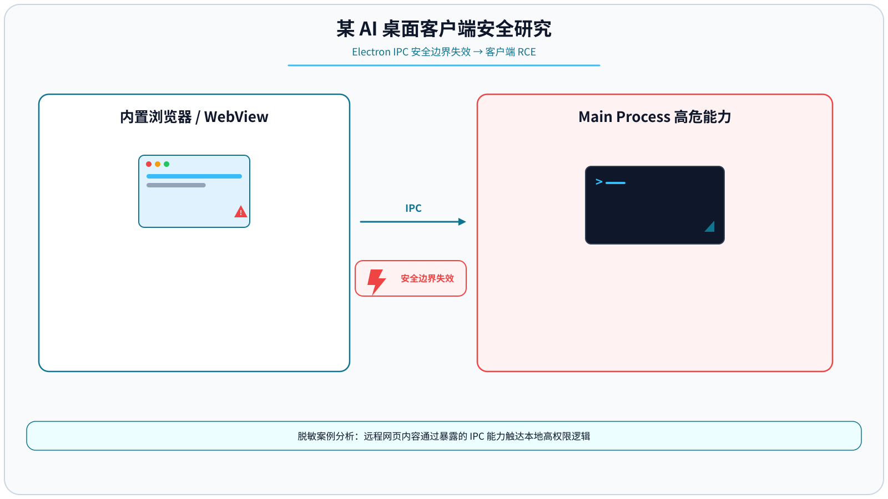

## 调用是怎么漏出去的

正常情况下，网页应该待在浏览器沙箱里，不能直接调系统，更不该指挥主进程去做敏感操作。这款客户端没有守住。

preload 通过 `contextBridge.exposeInMainWorld`，把类似 `tabAPI.sendToMain()` 和 `ipcRenderer.send()` 的接口挂到了页面上。内置浏览器加载的页面，可以调用暴露在 `window` 上的这些接口，往主进程发 IPC。

我顺着这两个 send 看，调用来源、目标通道、页面 URL，都没有充分校验。用户只要在这个客户端的内置浏览器里打开攻击者控制的页面，页面就可能去用这些本地能力。

## Electron 里这层边界本该在哪

Electron 通常就两块：Renderer Process 负责把页面画出来，Main Process 负责窗口、系统调用、文件、更新，以及 IPC 本身。

页面和主进程要通信，只能走 IPC。合理的做法是 Renderer 不能直接拿到任意 IPC，preload 只暴露业务必需的最小接口，通道有白名单，高危通道要校验调用来源，下载、安装、执行还得在主进程再验一次。

这款客户端把通用的发送能力直接交给了网页，主进程里的敏感通道又没有来源、签名或参数校验。远程网页就从普通页面，变成了可以调用本地能力的一端。

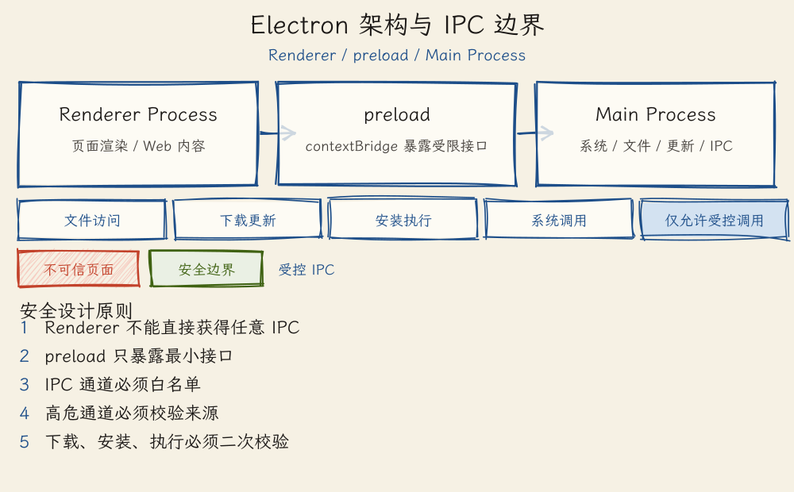

## 我顺着三条逻辑往下看

### send 没有门禁

上面说的 `sendToMain()` 和 `ipcRenderer.send()`，消息可以直接转到主进程。谁在调、调哪条通道、页面是哪个 URL，都没拦住。

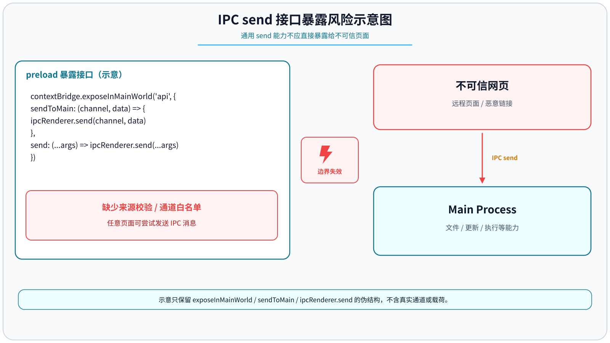

### 更新下载信了传入的地址

主进程的下载逻辑把传入的 URL 当成下载地址，文件保存到固定目录。没有严格确认是不是官方更新域名，也没有限制协议、文件类型和来源。

攻击者通过 IPC 指定一个外部 URL，客户端就会从那边把文件下到本机。就算先不谈后面的执行，远程页面已经能往用户机器的固定目录写文件了。

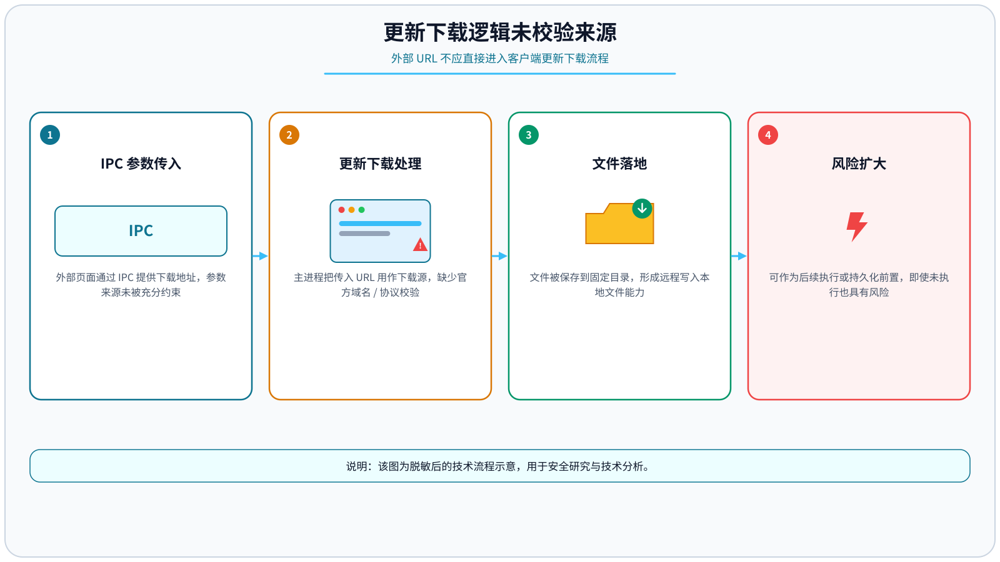

### 安装只看文件在不在

安装接口拿到路径之后，只检查文件是否存在，然后进入安装。Windows 上会用到 PowerShell 的 `Start-Process`，并带 `-Verb RunAs` 请求管理员权限。

这里缺了几件事：没有校验文件是不是官方签名，没有校验是不是来自官方更新服务器，没有限制可执行文件类型，也没有把下载和安装绑在同一次可信的更新上下文里。

下载和安装都能被任意网页用 IPC 串起来时，客户端 RCE 就成立了。

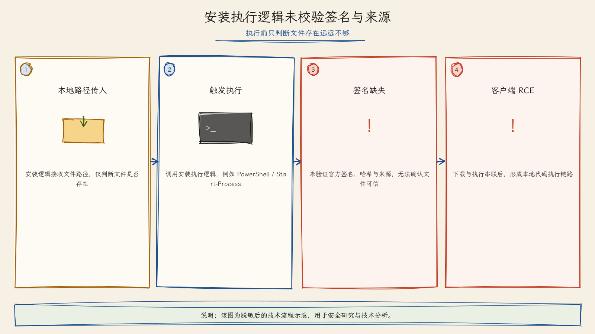

## 链路我是这么串起来的

从攻击者的角度看，并不需要新接口，把客户端里已经存在的行为连上就行。

先让用户在内置浏览器里打开页面。链接可以伪装成文档、活动页面、资源领取，看起来很普通。页面一旦在这款 AI 桌面客户端的内置浏览器里打开，就进了触发环境。同样的页面放到 Chrome 或 Edge 里走不通：普通浏览器不会暴露主进程 IPC，也调不到本地的更新和安装。

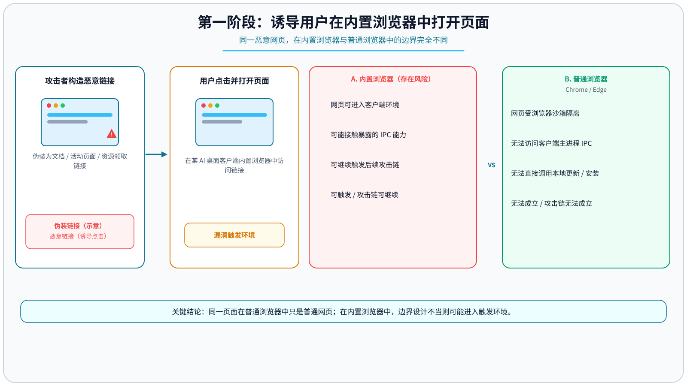

页面加载之后，调用已经暴露的 IPC，向主进程发消息。send 这一类接口没有来源和通道限制，外部页面就能碰到不该给它的主进程能力。

接着走更新下载相关的通道，把外部文件地址传进去。主进程按更新流程把文件下到用户本地目录。远程页面本来不该有往固定目录落文件的能力。

文件落地之后，再调安装相关的通道，把本地路径交回去，客户端就会执行这个文件。我验证的时候只用无害程序，或者弹一个计算器，确认代码确实执行了。到这里链路就闭环了。

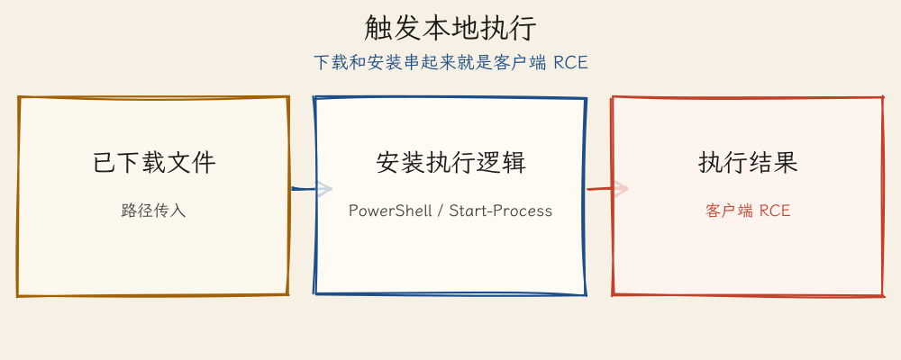

## 为什么我不把它当成普通网页问题

容易看成「用户得点开链接，事情又发生在内置浏览器里」。入口确实是远程内容：控制一个网页，让用户在这个客户端里打开。但执行发生在受害者自己的 Windows 上，跑的是下到本机的文件，不是服务端代码。执行能力来自主进程里那些高权限通道，普通网页自己并没有执行本地文件的本事。

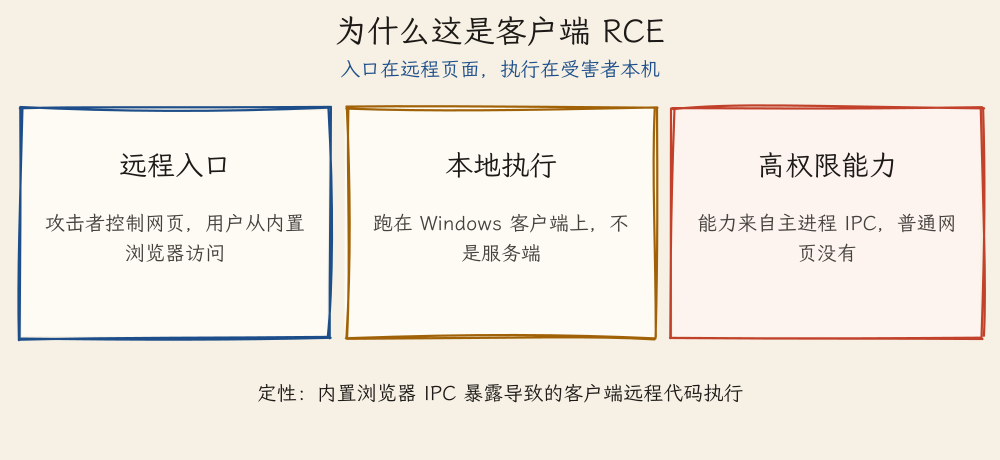

## 落到机器上会怎样

正常浏览器里，网页读不了本地文件，写不了固定路径，也执行不了程序。在这个内置浏览器里，网页可以借 Electron IPC 去做这些事，沙箱等于被绕开了。

即便后面的执行被 UAC 挡住，远程页面已经能让客户端把指定文件下到本地固定目录。这本身就有用：诱导用户手动打开、配合 DLL 劫持、覆盖或伪装更新文件，或者只是给后面的持久化做准备。

下载和执行串起来，就是从远程页面到本机代码执行。UAC 弹出来的话，提权还要用户确认，但这不改变它是客户端 RCE。

还有使用习惯上的差别。AI 客户端里，用户更容易相信内置页面、智能体给出的链接，或者对话里出现的内容。链接如果伪装成智能体资源、文档、插件说明或活动页面，被点开的概率会更高。

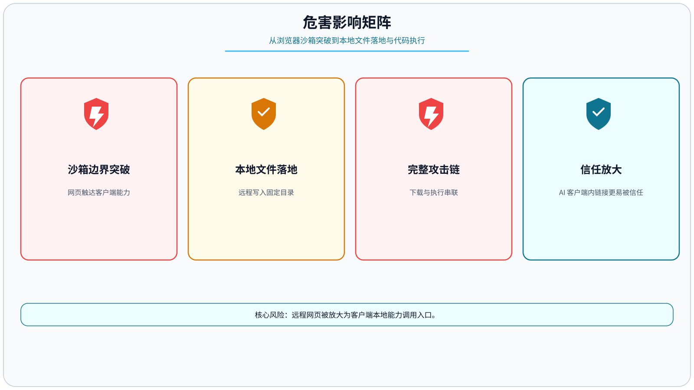

## 要修的话我会动这几处

preload 不应该向任意页面暴露通用的 `ipcRenderer.send()`。只留业务真正需要的最小接口，也不要把通用 IPC 直接挂到 `window` 上。

`sendToMain` 这类入口要限制能调用的通道。页面导航、标签页切换可以留；更新下载、安装执行、文件读写、命令执行不能让 Renderer 任意指定 channel。

外部网页默认不给敏感 IPC。只有来自官方域名、并且校验过的页面，才允许碰一部分受限接口。来源不能只在前端看 URL，主进程要再验一次。

更新下载至少要确认：域名在官方白名单里、协议是 HTTPS、证书有效、文件名和类型符合预期、这次下载确实来自更新流程。不能让外部页面传入任意 URL 当更新包地址。

安装之前要验数字签名。文件应由官方证书签名，签名链有效，哈希和更新元数据一致，下载地址和更新清单对得上，而且这次安装要对应到用户看得到的那次更新。只检查文件在不在，不够。

下载、安装、执行、访问本地文件，都应该有日志和拦截。外部页面来调更新安装通道时直接拒绝，并记下来源 URL、调用通道和参数摘要，方便事后查。

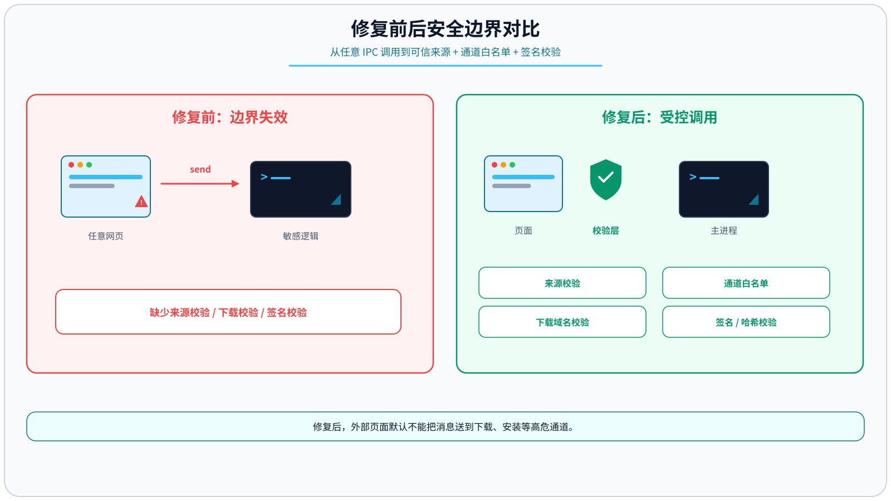

## 写在最后

这条链本身不复杂：不可信网页和主进程的高权限 IPC 被接上了，远程页面就能触发本地下载和执行。

preload 暴露得太宽，send 不看来源，下载不看来源，安装不看签名和来源。叠在一起就是客户端 RCE。

AI 桌面客户端往往还带着账号、文件、插件、WebView、模型调用和本地系统接口。IPC 边界没设计好的时候，远程内容拿到的能力会远超过一个普通网页。

所以关键不只是「能不能调 IPC」，而是谁在调、从哪里调、能调哪些通道、参数可不可信、主进程有没有再验一次、最后会不会碰到本地的高危能力。漏掉其中一环，普通网页就可能变成执行入口。

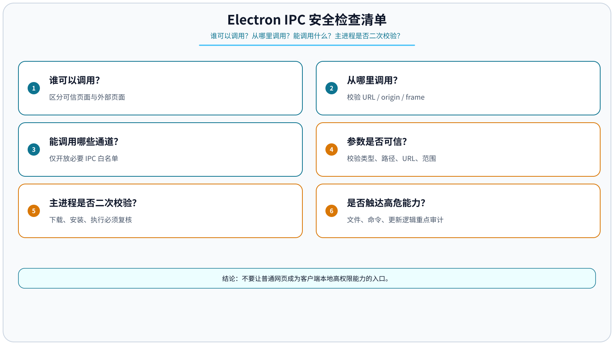

## 致谢与参考

本文部分思路借鉴了 Chen’s Blog 关于客户端应用漏洞挖掘的技术分享，特别是“Web 类客户端 / Electron”部分所提出的架构分析和利用思路。非常感谢Key佬无私分享的经验和实践案例：[被忽视的暗面：客户端应用漏洞挖掘之旅](https://gh0st.cn/archives/2023-12-18/1)
